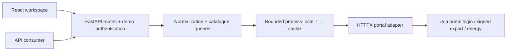

# Architecture and decisions

## Data flow

The Python package has four responsibilities: `portal.py` implements observed upstream requests/session behavior; `service.py` normalizes and queries records and builds the hierarchy; `cache.py` handles freshness/single-flight fills; `main.py` owns HTTP contracts, authentication and static frontend serving. Pydantic models define responses in `models.py`. The frontend uses those public responses only and never talks directly to the portal.

## Why this stack

FastAPI/Pydantic keep validation, serialization and OpenAPI close to the implementation. HTTPX owns one reusable cookie jar/client for a service process. uv and npm lockfiles make installations reproducible. React/TypeScript handles a modest interactive directory; Vite builds static files served by the API, so no second production server is required. TanStack Query cancels and deduplicates browser requests; Recharts is loaded only when a profile chart is needed. Plain CSS provides a responsive interface without a separate UI framework.

One Docker service is appropriate for sessionful portal access and a small dashboard. It runs as an unprivileged user. A separate frontend host, serverless functions, Redis, Postgres, a task queue and browser automation are not justified by the observed 403-record source.

## Catalogue and queries

The normal signed export provides a complete catalogue, coordinates, installation metadata and both page-format variants. It replaces N+1 detail scraping. An in-memory snapshot is validated and atomically published only after the exported count matches the response length, meter IDs are valid/distinct, and records normalize successfully. The previous expired snapshot is not silently returned on failure.

Search/filter/sort/page operations run over that snapshot. Search is intentionally limited to meter ID and serial, matching the obvious user lookup workflow. Status and hierarchy filters are supported because the complete export makes them inexpensive and correct across all records. No persistent index or ingestion job was introduced.

## Hierarchy correctness

Source names are not identifiers. Codes can conflict across ancestry, so node IDs are stable hashes of level/code/parent identity. Every meter contributes its observed path; counts use distinct meter IDs per path. Names are sorted deterministically, with extra names retained as aliases. Nodes sharing the same level/code but different parents warn about ambiguous placement. Missing levels terminate ancestry; no synthetic feeder-to-substation shortcut is created. The result is a forest with unresolved roots, not a claim that inconsistent source data describes one canonical physical network.

## Freshness and concurrency

The catalogue and derived graph share a 300-second TTL. Energy uses a 60-second TTL keyed by meter and dates. Both are configurable down to zero for cache bypass. A single bounded 128-entry LRU stores values; a small fixed array of locks collapses duplicate simultaneous fills without leaking per-key lock objects. A cache hit includes its original retrieval time and current age.

The portal adapter serializes logical operations, including login and export signing, because a shared mutable session must not race a refresh. The separate semaphore limits waiting logical calls at the adapter boundary. This favors predictable session correctness over throughput. One request can involve multiple bounded HTTP calls and retries; this demo does not claim a strict overall request-duration SLO. Multiple workers would create independent sessions/caches and independent quotas; that is outside the selected deployment.

## Errors and recovery

GET requests get at most one retry for connection/timeout failures and 502/503/504; the login POST is not blindly replayed. 429 from the portal is surfaced, not hammered. Recognized expiry gets one login recovery; signed export restarts signing if the session changes. Empty data is distinct from a malformed response, login HTML, or failed source call. Decimal fields preserve precision; invalid measurements become null with a warning, while invalid timestamps fail rather than fabricate a date.

The application logs method, URL path (not query), status, duration, and generated request ID. It does not log headers, response bodies, credentials, signing secrets or cookies. Production disables Uvicorn access logs, and HTTPX/HTTPCore logs are reduced to warnings.

## Demo access

A random shared bearer token gates every data route. The frontend keeps the token and response cache in memory and clears both on sign-out; no token appears in localStorage, sessionStorage or a URL. The public shell, health endpoint, and schema contain no live data. The API returns `Cache-Control: no-store` for data responses; its explicit internal cache is independent of browser/CDN caching. A global per-process quota limits authenticated reads to 120/minute.

This is a protected demo, not production user management. There is no tenant isolation, individual audit identity, refresh-token system, edge abuse protection or distributed quota. A production version should use proper per-user authorization and a managed reverse proxy before widening access. Portal credentials and management tokens are separate; the Docker process receives only the former plus the demo token.

## Assumptions, omissions and next improvements

- Asia/Kolkata is an assumption; the source does not supply timezone metadata. Preserve original timestamps so the assumption can be revisited.
- Source energy is interpreted as a cumulative register. Computing usage requires verified reset/rollover semantics and interval quality checks.
- Completeness is established by the export count for one snapshot, not by comparing every field to every individual meter page.
- Fixed June 2026 data remains historical even when retrieved today. Do not label it live energy telemetry.
- The in-memory approach uses O(meters + hierarchy paths + cached readings) memory; catalogue search scans O(meters), and catalogue rebuilds run synchronously on a miss. It is suitable for this observed dataset, not a measured million-meter solution.
- With another day: add an upstream session soak, wider sample comparisons between exports/detail pages, measured latency/memory benchmarks, and explicit cancellation/overall request deadlines. With a larger catalogue, introduce indexed persistent snapshots and background refresh only after measuring the need.
- No paid storage, map API, LLM integration, geo-radius search, anomaly detection, background scheduler or full user-account system is included.
